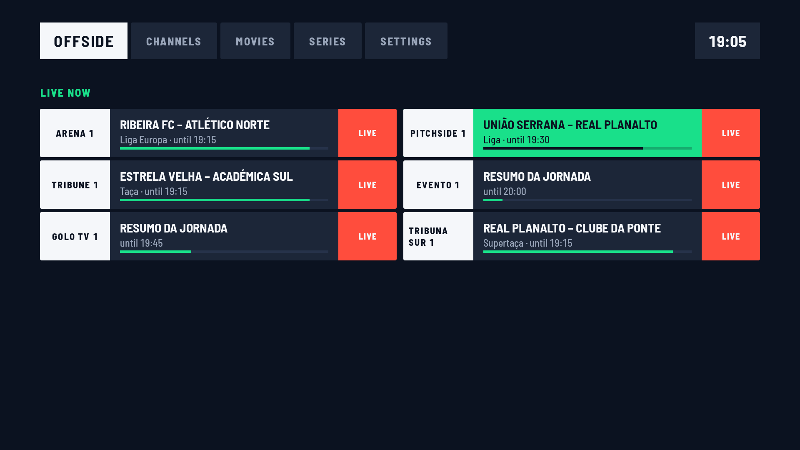
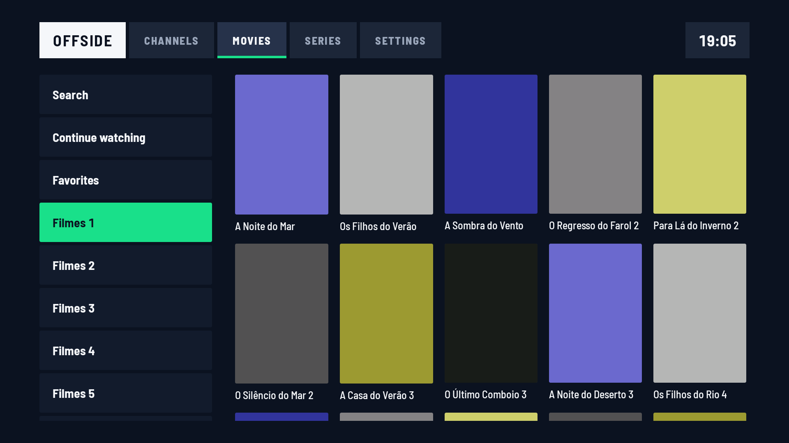
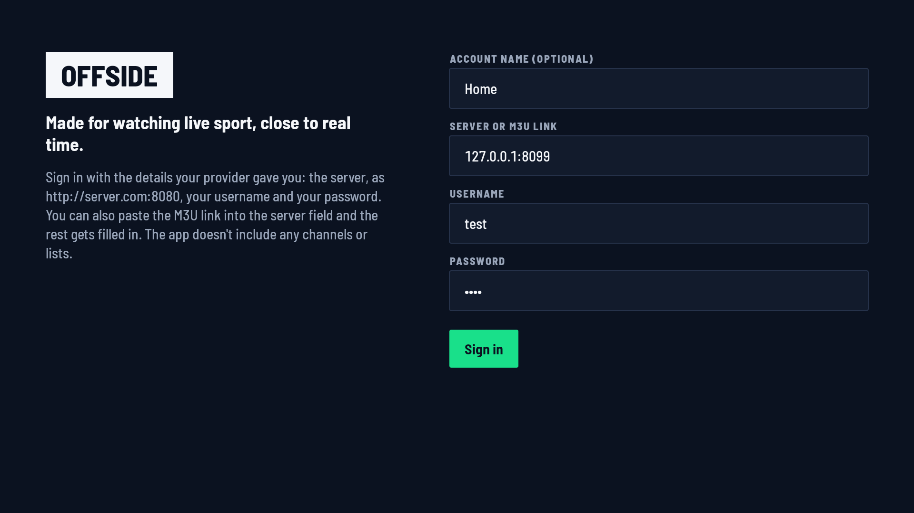
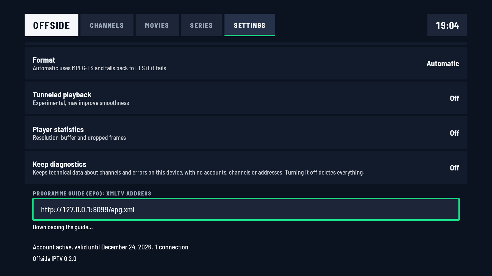

# Offside IPTV

An IPTV player for Android TV and Fire TV, built for watching live sport as close to real time as
the stream allows. It plays live channels, movies and series from your own Xtream account.

**The app has no channels, lists or accounts.** You need a subscription from a provider and the
details they gave you. Only use it with content you're allowed to watch.

*Em português:* um leitor IPTV para Android TV e Fire TV, feito para ver desporto em direto com o
mínimo de atraso. A app não traz canais nem listas: usa a tua conta Xtream ou o link M3U do teu
fornecedor. Está em português e em inglês. Para instalar, abre o Downloader na TV e escreve
`is.gd/offsideiptv`.

## Screenshots

Taken with the synthetic data from `tools/fake_xtream.py`: every channel, match and title is made up.

| | |
| --- | --- |
|  |  |
|  |  |

## Features

- **Low-latency live TV.** Three latency modes, buffer recovery and automatic reconnects.
- **Movies and series.** Continue watching, favorites, seasons and episodes, and audio and subtitle choice, including DTS and TrueHD audio through FFmpeg.
- **Programme guide (XMLTV).** What's on now and next, plus a "Live now" row of matches.
- **Several accounts.** Each account keeps its own favorites, progress, hidden categories and guide. You switch between them in Settings.
- **Xtream login or M3U link.** Paste your provider's M3U link and the app fills in the rest.
- **Portuguese and English.** Follows the device language, or you choose one in Settings.
- **Opt-in diagnostics.** See [Privacy](#privacy).

## Install

Requires Android 11 or later: Android TV devices such as the Nvidia Shield or Chromecast with
Google TV. Fire TV devices on Fire OS 8 should work: the app needs no Google services and was
tested on Android TV 11, which Fire OS 8 is based on. It hasn't been tested on a real Fire TV yet,
so reports are welcome.

1. Install **Downloader** from your TV's app store.
2. Open it and type **`is.gd/offsideiptv`**. It always downloads the latest version from [Releases](../../releases/latest).
3. Allow Downloader to install apps when Android asks, then install.
4. Open Offside and sign in with your provider's server, username and password, or paste the M3U link into the server field.

You can also download `offside-iptv.apk` from [Releases](../../releases/latest) and install it with `adb install`.

**About the warning when installing:** Android may say the app is unknown or that Play Protect
hasn't scanned it. That's expected for any app installed outside the store: choose **Install
anyway**. The source code is public and every release is built from it by
[GitHub Actions](../../actions/workflows/release.yml).

## Privacy

- Account details stay on the device, encrypted with a key from the Android Keystore.
- The app never logs addresses or credentials.
- **Diagnostics are off by default.** If you turn on *Keep diagnostics*, the app keeps technical data on the device:
  - playback sessions;
  - a short event log;
  - crashes.

  Addresses, IPs and account details are removed before anything is saved. *Send diagnostics* shows a QR code that opens a prefilled GitHub issue on your phone, next to the exact text that will be sent. Nothing leaves the device unless you submit that issue. Turning diagnostics off deletes everything.

## Reporting a problem

Turn on *Keep diagnostics* in Settings, reproduce the problem, then use *Send diagnostics*. You can
also [open an issue](../../issues/new/choose) by hand. **Never paste your server address,
username, password or M3U link into an issue.**

## Building

You need JDK 21 and the Android SDK. Set the SDK path in `local.properties`, then run:

```bash
./gradlew assembleDebug
```

Release builds are signed with the key described in `keystore.properties`. Both files stay out of
Git. Turn on the commit hook, which blocks credentials and local files:

```bash
git config core.hooksPath .githooks
```

To also block your own details, add one value per line to `.githooks/denylist.local`, for example
your server or username. That file is ignored by Git.

## Tests

Parsing and rule tests run on the computer. Database and sync tests need a device connected by ADB.

```bash
./gradlew testDebugUnitTest
./gradlew connectedDebugAndroidTest
```

[`tools/fake_xtream.py`](tools/fake_xtream.py) serves synthetic channels, movies, series and a
guide, so you can try the app without a real account. Usage is at the top of the file.
[`tools/sessions.py`](tools/sessions.py) summarises the diagnostic session files copied from a device.

## Licence

GPL-3.0. See [LICENSE](LICENSE) and [THIRD_PARTY_NOTICES.md](THIRD_PARTY_NOTICES.md).

## How this was built

Built with the help of an AI coding assistant (Claude Code).
