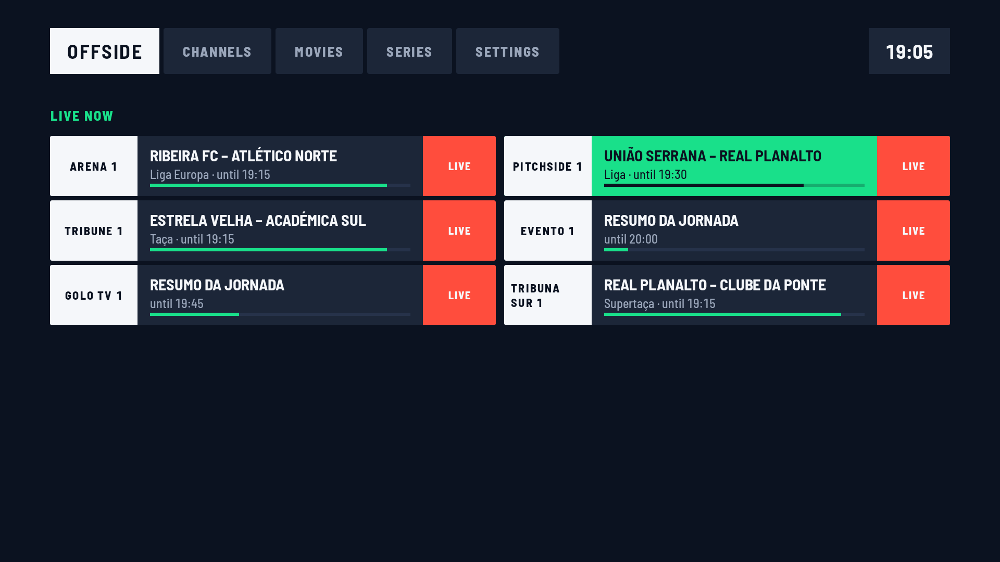

An IPTV player for Android TV and Fire TV, built for watching live sport as close to real time as
the stream allows. It plays live channels, movies and series from your own Xtream account or M3U
link. Free, open source (GPL-3.0), no ads and no tracking.

**The app has no channels, lists or accounts.** You need a subscription from a provider.

## What it does

- **Low-latency live TV**, with three latency modes, buffer recovery and automatic reconnects.
- **Movies and series**: continue watching, favorites, seasons and episodes, audio and subtitle choice, DTS and TrueHD through FFmpeg.
- **Programme guide (XMLTV)**, with a "Live now" row of the matches on air.
- **Several accounts**, each with its own favorites, progress and guide.
- **Xtream login or M3U link**: paste your provider's link and the rest is filled in.
- **Portuguese and English.**
- **Opt-in diagnostics**: off by default. When something fails, a QR code opens a prefilled email or GitHub issue on your phone, with no account details.

## New in 0.3.1

- The diagnostics QR code is about half as dense, so it reads from the sofa.
- Diagnostics can be sent by email, so reporting a problem no longer needs a GitHub account.
- Coming back from a category keeps your place, and the top menu is reachable from every screen.

## Install

Requires Android 11 or later: Android TV devices such as the Nvidia Shield or Chromecast with
Google TV. Fire TV devices on Fire OS 8 should work but haven't been tested on a real device yet:
reports are welcome.

1. Install **Downloader** from your TV's app store.
2. Open it and type the code **`9183430`**, or **`is.gd/offsideiptv`**. Both always download the latest version.
3. Allow Downloader to install apps when Android asks, then install.

Android may warn that the app is unknown or "Play Protect" hasn't scanned it. That's expected for
any app installed outside the store: tap **Install anyway**. The source code is public and every
release is built by GitHub Actions from it.

## Problems and ideas

Email **offsideiptv@gmail.com**, no GitHub account needed, or open an issue here. Never send your
server address, username, password or M3U link.

---

*Em português:* um leitor IPTV para Android TV e Fire TV, feito para ver desporto em direto com o
mínimo de atraso. Usa a tua conta Xtream ou o link M3U do teu fornecedor. Para instalar, abre o
Downloader e escreve o código `9183430`. Problemas ou ideias: offsideiptv@gmail.com.
